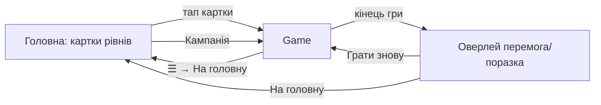

# GDD: «Серце Підземелля» — порт на Godot 4 (Android)

Еталон механік, чисел і вигляду — `web/` (архітектура: `web/CLAUDE.md`). Цей документ описує, що переносити, і детально — нове: мобільний UI. Числа тут не дублюються — їх переносять 1:1 з джерел.

## 1. Концепт
Tower defense в підземеллі для телефонів: гравець-володар селить монстрів у ніші біля коридору, авантюристи йдуть коридором до Серця. Для любителів стратегічного TD з великою кампанією (100 набігів) та різними рівнями. Кайф — підбір комбінацій монстрів проти складів набігів, які видно наперед.

## 2. Платформа і стек
- Godot 4.7.2, GDScript, renderer Mobile, Android. Розробка/тести — на ПК (headless + вікно).
- Базова роздільність 1280×720, альбомна, stretch `canvas_items`/`expand`. Миша емулює тач.
- Графіка лише `_draw()` (примітиви), без ассетів. Шрифт — системний/вбудований (Cinzel не обов'язковий).
- Дані балансу — в `godot/data/` (словники/ресурси GDScript), перенесені 1:1 з:
  - монстри: `web/js/monsters/monsters.js` (+ структура рівнів/`LEVEL_STATS` у `monster.js`);
  - авантюристи: `web/js/adventurers/adventurers.js` (+ `adventurer.js`);
  - набіги: `web/js/waves/campaign.js` (+ `wave.js`);
  - рівні: `web/js/levels/levels.js` (+ `level.js`);
  - загальне: `web/js/config.js` (`CELL`=40, `COLS`=20, `ROWS`=12, `START_MONEY`, `MAX_TOWERS`=18, `MAX_LEVEL`=10, `SELL_REFUND`=0.6, `CAMPAIGN_WAVES`=100, `DEFAULT_PATH`, `DEFAULT_TORCHES`, `hash()`).
- Ігровий світ — 800×480 «світових» px (20×12 клітинок по 40 px); швидкості в px/с, відстані в клітинках — як у вебі.

## 3. Core loop
- 30 с: набіг іде коридором → монстри б'ють авантюристів → зароблені душі → вибір, куди поставити/що посилити.
- 5 хв: 3-6 набігів: перегляд складу наступного набігу в панелі, адаптація (детектор проти невидимих, маги, броня), старт набігу.
- Сесія: пройти рівень (n набігів) або кампанію (100); автосейв між набігами, продовження з початку набігу.

## 4. Функції/механіки (переносити за еталоном)
Деталі й числа — у джерелах; тут — що має поводитись так само.

### 4.1 Ресурси і правила
- Душі (`money`) — валюта; Міцність Серця (`lives`) — HP; поразка при 0 або коли дійшла `wagon` (`setFatal`).
- Поселення — клітинка поза коридором (`PATH_CELLS`) і завалами (`ROCK_CELLS`), не зайнята; ліміт `MAX_TOWERS`; `unique`-монстри — по одному; `canAfford` перевіряє все це.
- Посилення до 10 рівня (`setLevel`, `upgradeCost`); продаж = `floor(spent × SELL_REFUND)`.
- Нагорода за вбивство — `reward` авантюриста за силою на набігу.

### 4.2 Монстри (13 видів, ролі attack/support/buff/economy)
Види атак, які треба реалізувати (див. `entities.js`, `Tower`, `ATTACKS` у `monster.js`):
- `projectile` (скелет-лучник, імп: сплеш, сповільнення, отрута, ланцюг `jump`), `aura` (привид — сповільнення/`haunt`), `beam` (біхолдер: фіксований напрямок `dir` з `DIRS`, смуга `beamWidth`, `minRange`), `web` (павук: конус `cone`, оглушення `hold` з `stun(t, webbed)`).
- Особливі: `drain` вампіра (`links`), `cleave` лат (ближній + фізичний сплеш), `buff` котла відьми (`tower.buffs`, варяться в `startWave` через `brew()`), `grave` кладовища (кожна `every`-та смерть → `souls`), орк `manual` (валун `Boulder`: відкидання через `setProgress`, крім `steadfast`; після набігу дає новий валун; кидок — вручну), `slime`, `golem`, `lich`.
- Прицілювання: `TARGET_MODES` (перший/останній/сильний/слабкий/ближній, «перший/останній» — за відстанню до Серця `Enemy.left`), `Tower.priority`/`betterTarget` (undying — останнім), `canHit`, `reaches`; детектори підсвічують невидимих (`REVEAL_TIME`=2 с).
- Урон завжди через `Enemy.hit(dmg, pierce, src)`.

### 4.3 Авантюристи (13 видів)
Воїн, злодій, паладин (щит `shieldAura` поглинає й по сусідах), гном (`physArmor`, не діє проти магії), носій прапора (`hasted` — прискорює, `undying` поки є не-`undying`), жрець (лікує, `setEscort` — лише з паладином), маг (`magicWard` гасить магічний урон по собі й поруч), розвідник і шут (невидимі `hidden`/`revealed`; шут при смерті — половинки), вершник (при смерті воїн), майстер меча, герой-бос, телега (`setSpawnOnDeath`, `setFatal`, дуже повільна). Ніхто не обганяє попереднього в загоні (`leader`, `FORMATION_GAP`).
- Сила з набігами: опорні точки `setWave(n, {hp, speed, reward, armor, splitReward})`, лінійна інтерполяція, після останньої — тим самим темпом (`Adventurer.statsAt`); + баф групи/набігу (`waveBuff`, `mergeBuff`, `adventurerStats`).
- Відкриття типів за набігом (`ENEMY_UNLOCK`), позначка «новий» (`game.seen`).

### 4.4 Набіги, рівні, шляхи
- `WAVES` з `campaign.js`: групи `[тип, к-сть, інтервал, пауза?, баф?, вантаж?]`; група з паузою — новий загін; `cargo` — вантаж телеги. Склад детермінований (`hash`, без `randf`): `routeFor`, `waveSpawns` — спільні для старту набігу й панелі.
- Рівні (`LEVELS`): кількість набігів `setWaves(n)` (завжди з 1-го), `setMoney`, `setLives`, набір монстрів, `paths` (кілька входів: зліва/згори/знизу, спільні ділянки, вага = частка загонів), `rocks`, `torches`. Валідація як у `build()`.
- Мапа: коридор, ніші, факели, ґрати входів з літерами шляхів (A, B…), завали, Серце за правим краєм, віньєтка — статичне малюється в кеш (текстура/`SubViewport` або кеш `_draw`), мерехтіння — від глобального часу.

### 4.5 Автосейв
Слот на вхід (`campaign` / `level-<id>`). Пишемо між набігами (після зачистки, поселення/посилення/продажу) і при виході з застосунку/паузі ОС (`NOTIFICATION_APPLICATION_PAUSED`, `WM_CLOSE`). Продовження з початку набігу. Поразка/перемога/«Грати знову» стирають сейв. Формат — `user://`, поле `SAVE_VERSION`. Прогрес «рівень пройдено» і мова — окремо в `user://`. Нове поле, що живе між набігами, — у snapshot/restore (див. `save.js`).

### 4.6 Мова
UA/RU (`L('укр','рос')`), вибір зберігається; перемикання застосовується одразу (достатньо оновити UI, перезапуск сцени не обов'язковий). Тексти даних (імена/описи) — двомовні.

## 5. Сутності і числа
Усі числа — у `godot/data/` за джерелами з розділу 2. Єдине зведене місце глобальних констант — `data/balance` (CELL, COLS, ROWS, START_MONEY, MAX_TOWERS, MAX_LEVEL, SELL_REFUND, CAMPAIGN_WAVES, REVEAL_TIME, FORMATION_GAP, LEVEL_STATS). Нових чисел балансу немає. Нові числа лише UI (таблиця нижче).

| Параметр UI | Значення |
|---|---|
| Мін. розмір цілі дотику | 48 dp (≈ 64 px при 1280×720) |
| Довге натискання | 0.4 с |
| Допуск зсуву для тапу | 12 px |
| Ширина висувної панелі | 340 px (≈ 27% ширини) |
| Анімація висування | 0.2 с |
| Швидкості гри | ×1 / ×2 / ×3 |
| Безпечні поля (вирізи) | брати `DisplayServer.get_display_safe_area()` |
| Підказка авантюриста: автозакриття | 4 с або тап повз |

## 6. Прогресія і економіка
Як у вебі: душі від вбивств і кладовища, стартові `START_MONEY`/`setMoney` рівня; стоки — поселення, посилення (до 10 р.), втрата 40% при продажу. Сила авантюристів росте за `setWave`. Прогресія між сесіями: лише прапорці «пройдено» рівнів (`markLevelDone`) і автосейв.

## 7. Екрани і UI (мобільний, альбомний)

### 7.1 Карта переходів

Кнопка «Назад» Android: у грі — відкрити паузу-меню; закриває спершу відкриту панель/підказку; на головній — вихід (подвійне натискання).

### 7.2 Головна
- Горизонтальна прокрутка (свайп) карток рівнів + картка «Кампанія» (100 набігів) першою; продовження з автосейву позначено («Продовжити, набіг N»).
- Картка (≈ 360×300 px): мініатюра мапи (малюється тими ж функціями), назва, кількість набігів, іконки монстрів рівня, іконки авантюристів (з `waveGroups`), позначка «пройдено», кнопки «Грати» / «Нова гра» (якщо є сейв, нова — з підтвердженням).
- Перемикач мови UA/RU — верхній правий кут, 64×64. Безкінечний режим у MVP — відсутній (картки немає).

### 7.3 Ігровий екран
Мапа займає весь екран з масштабуванням (див. 7.7). Поверх — мінімум елементів:
- **Верхня смуга (HUD, прозора)**: ліворуч душі 💀 і міцність Серця ❤, по центру «Набіг N/M», праворуч кнопки: ⏸ пауза, ⏩ швидкість (цикл ×1→×2→×3), ☰ меню. Дрібний шрифт не менше 18 px.
- **Кнопка «Старт набігу»**: велика (≈ 220×72), знизу по центру над мапою, видима між набігами; під час набігу замінюється індикатором «ідуть: X». Перемикач «Авто» — поруч (як `game.auto`).
- **Ліва кнопка-язичок «Набіг»** (по краю, середина висоти) — висуває панель набігу.
- **Права смуга-язичок** — висуває панель магазину/посилення.
- Одночасно відкрита лише одна панель; тап по мапі повз панель — закриває її (панель магазину при цьому не закривається, якщо активне поселення — див. 7.4).

### 7.4 Керування тачем (без hover)
Стани: `Idle` → `Placing(тип)` → `Selected(монстр)`.
- **Вибір монстра в магазині**: тап по картці в правій панелі → `Placing`. Картка підсвічується; недоступна (немає душ/ліміт/`unique`) — приглушена, тап показує причину в тості («Мало душ», «Ліміт 18», «Вже є»).
- **Поселення — двокроковий тап**: тап у клітинку мапи ставить «привид» монстра з колом дальності (valid — зелений/invalid — червоний) і кнопками ✔ (поселити, показує ціну) та ✖ під клітинкою; тап в іншу клітинку переносить привид; ✔ — поселити. Перетягування пальцем також рухає привид (клітинка під пальцем зміщується вгору на 1.5 клітинки, щоб палець не закривав). Після поселення — лишаємось у `Placing` того ж типу (швидке розставлення), закрити — ✖/тап по кнопці типу/«Назад».
- **Вибір поселеного монстра**: тап по монстру → `Selected`: коло дальності, права панель автоматично відкривається на вкладці «Посилення». Тап по порожній клітинці в `Idle` — зняти вибір.
- **Посилення**: вкладка показує «зараз → після» (`towerStats`, рядки `statRows`), кнопку «Посилити (ціна)» (≥ 56 px заввишки), «Продати (сума)» — продаж потребує підтвердження повторним тапом по кнопці упродовж 2 с (текст змінюється на «Точно?»).
- **Режим цілі**: у вкладці — рядок з 5 чіпів `TARGET_MODES` (перший/останній/сильний/слабкий/ближній), лише для монстрів, що самі обирають ціль (`Tower.aims`). Тап по чіпу — застосувати.
- **Біхолдер (`fixedDir`)**: у вкладці — кнопки напрямку (стрілки/колесо з `DIRS`); на мапі показується смуга-превʼю.
- **Орк (кидок валуна)**: якщо валун є — кнопка «Кинути» у вкладці; тап → режим цілі: тап по мапі, показує точку падіння; повторний тап/✔ — кидок. (Заміна подвійного кліку.) Також кнопка-іконка з валуном над орком на мапі.
- **Підказки про авантюристів (замість hover)**: у панелі набігу тап по рядку → картка `showFoeTip` (сила на цьому набігу, `enemyTraits`); закривається по тапу повз/4 с. На мапі тап по авантюристу (хіт-тест радіус 28 px, найближчий) → та сама картка. Довге натискання (0.4 с) по картці монстра в магазині — повний опис і характеристики по рівнях (спрощений замінник 🔍).
- Жести на мапі: пінч/зум не потрібен (мапа вміщується цілком); один палець — лише тап/перетяг привида.
- Тач не повинен «протікати» через панелі на мапу (панелі поглинають input).

### 7.5 Панелі
- **Магазин (права)**: сітка карток 2 колонки (іконка `towerIcon`, назва, ціна), вкладки «Монстри» / «Посилення» вгорі панелі; прокрутка свайпом вертикально. У рівні лише його монстри.
- **Набіг (ліва)**: список груп наступного набігу (`waveSpawns`: іконка, к-сть, мітка шляху A/B…), позначка «новий», стрічка шляхів, якщо їх кілька; прокрутка.
- Кнопки/іконки панелей малюються тими ж `towerIcon`/`enemyIcon`.
- Панель під час набігу не ставить гру на паузу; відкрита картка огляду — ставить.

### 7.6 Меню паузи (☰ / ⏸ / «Назад»)
Продовжити, перемикач мови UA/RU, «На головну», «Почати рівень заново» (з підтвердженням). Гра на паузі, поки меню відкрите.

### 7.7 Кінець гри
Повноекранний напівпрозорий оверлей по центру: «Перемога»/«Поразка» (win/lose), набіг, статистика коротка (дійшли до набігу N, вбито), кнопки «Грати знову» (стирає сейв) і «На головну» (кожна ≥ 64 px). Перемога на рівні → `markLevelDone`.

### 7.8 Масштабування мапи
- Світ 800×480 (5:3); екрани 16:9…21:9. Мапа вписується **по висоті екрана** (`scale = viewport_h / 480`, при потребі — по ширині, щоб вміщалась цілком), центрується; вільні поля з боків (на широких екранах) заповнені темним тлом/текстурою каменю. HUD і панелі лежать у ці поля і поверх мапи; панелі перекривають мапу тільки висунуті.
- При 1280×720 scale = 1.5 (клітинка 60 px — достатньо для тапу). Мінімум scale для відносно малого екрана — не менше 1.0 (клітинка ≥ 40 px).
- Перерахунок координат тапу → клітинка через зворотне перетворення; реагувати на `size_changed` (поворот між landscape-варіантами, безкаркасні вирізи → `safe_area`).
- Радіуси хіт-тесту підняти до мінімум 24 px світових для зручності тапу.
- Усі UI-контроли — Godot `Control` (CanvasLayer) з якорями, не залежні від масштабу мапи; мапа — окремий `Node2D` з трансформацією.

## 8. Арт і звук
Як у вебі: темний «кам'яний» стиль, кольори з `web/style.css` (`:root`), малювання примітивами (`_draw`) за функціями `drawAdventurer`, `TOWER_DRAW`, `towerIcon`/`enemyIcon`, ефекти за `kind` (beam/bolt/quake/кола). Анімації — від глобального часу, не від ігрового `dt`. Звук і музика — не в MVP. Деталі палітри — агент `designer`.

## 9. MVP-обсяг
**В MVP:**
- Головна з картками рівнів + «Кампанія» (100 набігів), усі рівні з `levels.js`.
- Усі 13 монстрів і 13 авантюрників (усі атаки/особливості з п. 4.2-4.3), валуни орка.
- Шляхи, завали, факели, ґрати входів, панель набігу з міткою шляхів.
- Автосейв/продовження, `markLevelDone`, укр/рос перемикач.
- Мобільний UI з п. 7: HUD, висувні панелі, двокроковe поселення, посилення/продаж/режим цілі/напрямок біхолдера/кидок валуна, картки-підказки авантюристів, пауза/швидкість/старт/авто, оверлей кінця гри, масштабування мапи.
- Тест на ПК (headless): перевірка даних (набори рівнів/набігів збігаються з вебом), детермінованість складу набігів.
- `godot/ANDROID.md` (інструкція зі збірки APK).

**Потім:** безкінечний режим (`endless.js`, рекорд), музика, колонка статистики (урон/вбивства), вікно огляду монстра 🔍 (в MVP — довге натискання з коротким описом), відладка `?wave=&money=`.

## 10. Відкриті питання
1. Мінімальна версія Android і цільові пристрої (впливає на renderer Mobile/Vulkan і мін. розмір екрана)? Припущення: Android 8+, Vulkan.
2. Чи потрібна підтримка вертикальної орієнтації? Припущення: ні, лише альбомна (заблокована).
3. Чи потрібно іншомовне оновлення UI «на льоту» без перезапуску сцени (вигідніше), чи допустимий перезапуск сцени як у вебі? Припущення: на льоту.
